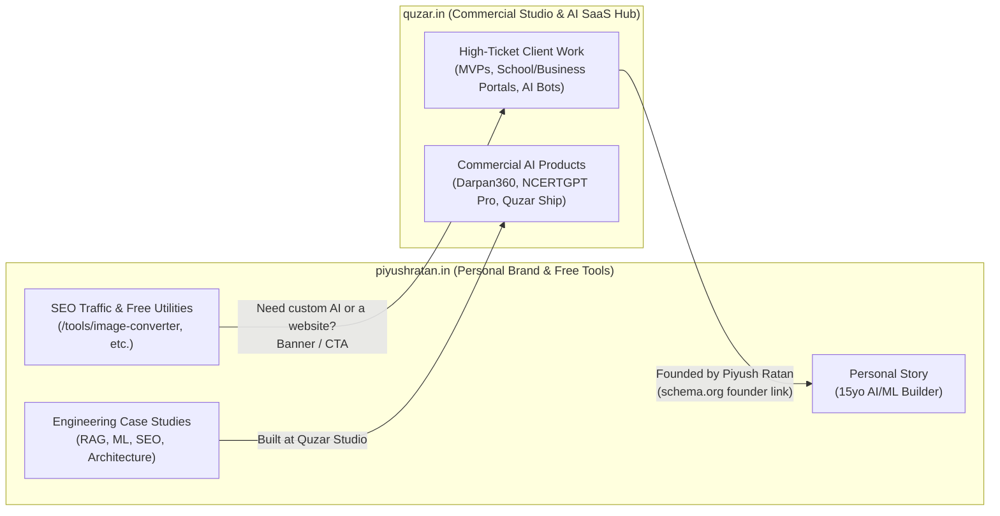
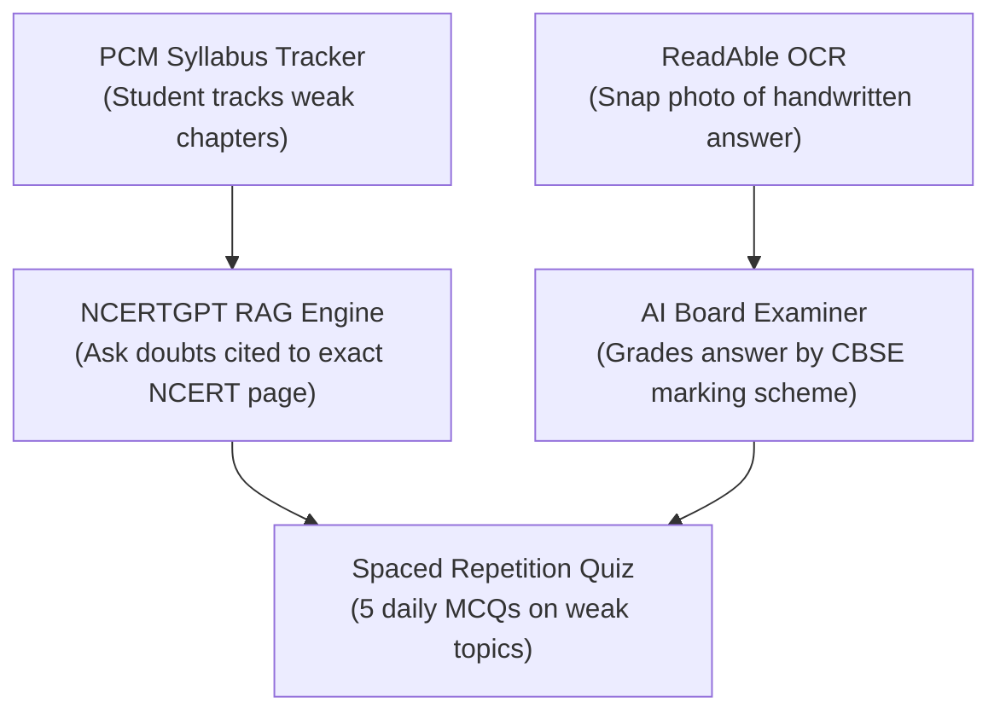

# Quzar Agency & Piyush Ratan — The Complete Solo-Founder Playbook

> **Tailored specifically for Piyush Ratan** ([piyushratan.in](https://piyushratan.in) | `@Piyush__Ratan` | `github.com/PiyushRatan`)
> **Philosophy**: *"Useful first, fancy later. Bias toward shipping, observability, and fewer mystery bugs."*

---

## Table of Contents

1. [What Your Online Footprint Reveals About You](#part-1-what-your-online-footprint-reveals)
2. [Connecting `piyushratan.in` + `quzar.in` (Your Two-Site Ecosystem)](#part-2-connecting-piyushratanin--quzarin)
3. [Honest Audit of Quzar (`quzar.in`) vs. Your Personal Site (`piyushratan.in`)](#part-3-honest-audit-of-quzar)
4. [Exact Website Enhancements for Quzar](#part-4-exact-website-enhancements-for-quzar)
5. [Public AI Tools & Products You Should Build Next](#part-5-public-ai-tools--products-you-should-build-next)
6. [Deep-Dive Architecture for Your Top 6 AI Products](#part-6-deep-dive-architecture-for-your-top-6-ai-products)
7. [ balancing Class 12 (PCM), Client Work & Product Building](#part-7-balancing-class-12-pcm-client-work--product-building)
8. [Distribution, SEO & Monetization Playbook](#part-8-distribution-seo--monetization-playbook)
9. [Immediate Action Checklist](#part-9-immediate-action-checklist)

---

## Part 1: What Your Online Footprint Reveals

After researching **Piyush Ratan** across Google and reading [piyushratan.in](https://piyushratan.in), [`/llms.txt`](https://piyushratan.in/llms.txt), [`/ai-profile.json`](https://piyushratan.in/ai-profile.json), `/work`, `/websites-built`, and `/tools`, several huge insights stand out:

### 1. You Are Already Ahead of 99% of Student Developers
At 15 years old (Class 12 PCM at Mount Litera Zee School, Farrukhabad), you have already shipped:
- **AI & ML Systems**:
  - **Darpan360**: A Chatbot-as-a-Service platform for controlled, domain-specific AI widgets on websites.
  - **NCERTGPT**: A RAG-based study assistant grounded in NCERT textbooks.
  - **CyberAlert**: An AI-assisted spam and phishing risk detector.
  - **ReadAble**: An OCR, text-to-speech, and translation accessibility utility.
  - **Audio to Text**: A speech-to-text backend pipeline.
  - **Regression Models**: Core ML foundations comparing regression algorithms.
- **Real Client / Institutional / Product Websites**:
  - **SDRP Inter College**
  - **Orlin AI**
  - **Vaultera**
  - **JMD Agency**
  - **Brothers Production Noida**
- **Free Public Web Utilities (`piyushratan.in/tools`)**:
  - Free Fire & BGMI Nickname Generator
  - Universal Image Format Converter (100% local HTML5 Canvas)
  - Text Formatter & Word Counter
  - Password Studio (local entropy & crypto generation)
  - Bulk UUID/GUID Generator
  - Developer JSON Studio

### 2. Your Technical SEO on `piyushratan.in` Is Elite
On `piyushratan.in`, you implemented:
- `/llms.txt` and `/ai-profile.json` for AI agents and LLM crawlers (which is literally how I just read your entire structured profile in seconds!)
- Comprehensive multi-entity `schema.org` JSON-LD (`Person`, `Organization`, `ProfessionalService`, `WebSite`)
- Canonical host guards redirecting Firebase preview domains (`gangsta-piyush.web.app`)

**Yet almost none of this SEO infrastructure or real project proof has been ported over to `quzar.in`!**

---

## Part 2: Connecting `piyushratan.in` + `quzar.in`

Right now, Google sees **Piyush Ratan** (`piyushratan.in`) and **Quzar** (`quzar.in`) as completely disconnected islands. Worse, `quzar.in` hides your best assets behind generic agency stock photos.

### How Your Two Websites Should Work Together

### Actionable Linking Strategy
1. **Cross-Link in Schema.org (`layout.tsx`)**:
   In `quzar.in`, declare `"founder": { "@type": "Person", "@id": "https://piyushratan.in#person", "name": "Piyush Ratan", "url": "https://piyushratan.in" }`. And on `piyushratan.in`, add `"owns"` / `"founderOf"` pointing to `https://quzar.in`. This transfers your domain authority and identity graph directly to Quzar.
2. **Add `/llms.txt` and `/ai-profile.json` to `quzar.in`**:
   Do the exact same thing you did on `piyushratan.in` so ChatGPT, Perplexity, and Google AI Overviews know that **Quzar is Piyush Ratan's AI product & development studio**.
3. **Use `piyushratan.in/tools` as a Lead Funnel for `quzar.in`**:
   Your free tools (Nickname Generator, Image Converter, JSON Studio) get organic search traffic. Add a clean, non-intrusive footer card on every tool page:
   - *"Studying for Boards? Try NCERTGPT"*
   - *"Need a custom website or AI chatbot for your business? Visit Quzar.in"*

---

## Part 3: Honest Audit of Quzar (`quzar.in`)

Here is what needs fixing in the `quzar-agency` repo right now based on what you *actually* have on `piyushratan.in`:

### 1. You Have Real Websites & Screenshots — Stop Using Unsplash Placeholders!
In [`frontend/data/projects.ts`](frontend/data/projects.ts), Quzar only lists 4 projects (`ncertgpt`, `cyberalert`, `vaultera`, `sdrp`), all with `liveLink: '#'` and generic Unsplash images.
Meanwhile, on `piyushratan.in/websites-built` and `/work`, you have **real screenshots** and **7+ real projects**:
- **Darpan360** (your strongest B2B AI SaaS project — missing from Quzar!)
- **Orlin AI** (missing from Quzar!)
- **JMD Agency** (missing from Quzar!)
- **Brothers Production Noida** (missing from Quzar!)
- **SDRP Inter College** (replace Unsplash image with your real screenshot!)
- **Vaultera** (replace Unsplash image with your real screenshot!)
- **ReadAble** & **PCM Syllabus Tracker**

### 2. Fake Corporate Logos in `ValueProp.tsx`
In [`frontend/components/sections/ValueProp.tsx`](frontend/components/sections/ValueProp.tsx#L46-L64), the grid displays **Stripe, Twilio, Spotify, 3M, P&G, American Airlines**.
- **Fix**: Replace these immediately with either:
  1. **Your real client/project names**: *SDRP Inter College, Brothers Production Noida, JMD Agency, Orlin AI, Vaultera, Darpan360*
  2. **Your real tech stack**: *Next.js, Python, Firebase, Gemini/OpenAI, Vector DBs, Tailwind CSS*

### 3. Stat Mismatches Across Pages
- On `piyushratan.in`, you actually have **7+ AI/ML & utility projects**, **5+ deployed websites**, and **6 live browser tools**.
- On `quzar.in`, [`Hero.tsx`](frontend/components/sections/Hero.tsx) says `3+ Years Building | 6 Products Shipped | 3+ Happy Clients`, while [`about/page.tsx`](frontend/app/about/page.tsx) says `5+ Shipped Projects | 3+ Happy Clients | 12+ Working Demos`.
- **Fix**: Unify them with your real numbers:
  - **5+ Deployed Client & School Sites** (SDRP, JMD, Brothers Production, Vaultera, Orlin AI)
  - **7+ AI & ML Systems Built** (Darpan360, NCERTGPT, CyberAlert, ReadAble, etc.)
  - **6+ Free Public Tools Live**

### 4. Broken Calendly Button in `contact/page.tsx`
Line 215 of [`frontend/app/contact/page.tsx`](frontend/app/contact/page.tsx#L215) triggers `alert('Calendly placeholder modal opened!')`. Wire this up to a real **Cal.com** link or WhatsApp Business link.

### 5. Hardcoded Firebase Config in `frontend/lib/firebase.ts`
Move the keys in [`frontend/lib/firebase.ts`](frontend/lib/firebase.ts) to `.env.local` using `NEXT_PUBLIC_FIREBASE_*` variables.

---

## Part 4: Exact Website Enhancements for Quzar

| Priority | File to Edit | What to Change |
|---|---|---|
| **P0** | [`frontend/data/projects.ts`](frontend/data/projects.ts) | Add **Darpan360**, **Orlin AI**, **Brothers Production Noida**, **JMD Agency**. Replace Unsplash URLs with your actual screenshots from `piyushratan.in` and real `liveLink` URLs. |
| **P0** | [`frontend/components/sections/ValueProp.tsx`](frontend/components/sections/ValueProp.tsx) | Replace Stripe/Spotify/3M/P&G with your real shipped websites (*SDRP Inter College, Brothers Production, JMD Agency, Vaultera, Orlin AI, Darpan360*). |
| **P0** | [`frontend/app/contact/page.tsx`](frontend/app/contact/page.tsx) | Replace `alert('Calendly placeholder...')` with a real Cal.com booking link + direct WhatsApp chat button (Indian clients love WhatsApp). |
| **P1** | [`frontend/app/about/page.tsx`](frontend/app/about/page.tsx) | Put **Piyush Ratan** front and center as the founder, linking to `piyushratan.in`. Founders love hiring a prodigious, fast-shipping builder directly. |
| **P1** | `frontend/public/llms.txt` & `ai-profile.json` | Add LLM discovery files to `quzar.in` just like you did on `piyushratan.in`. |
| **P2** | `frontend/app/tools/` or Navbar link | Add a **"LABS / TOOLS"** tab in Quzar's navbar showcasing your free AI tools and live demos (Darpan360, NCERTGPT, etc.). |

---

## Part 5: Public AI Tools & Products You Should Build Next

You asked: **"What future products should I work on as a single person, and what AI tools can I work on to provide to the general public?"**

Because you already built **client-side browser tools** on `piyushratan.in/tools` (zero server cost!) and **AI projects** (Darpan360, NCERTGPT, CyberAlert, ReadAble), your best strategy is a **Two-Layer Product Ecosystem**:

### Layer 1: Free Public AI & Web Micro-Tools (Traffic & Distribution Engine)
These are tools for the **general public** that cost you **₹0 to ₹500/month** to run (using either client-side WebAssembly/WebGPU/Canvas or ultra-cheap Gemini Flash with strict rate limits). Their job is to get **10,000+ monthly visitors from Google**.

1. **AI Scam / Phishing Message Checker (Public Version of CyberAlert)**
   - **Audience**: General public in India (parents, students, shopkeepers getting fake UPI/WhatsApp/SMS scam messages, fake job offers, "digital arrest" scams).
   - **How it works**: User pastes a suspicious SMS/WhatsApp message or uploads a screenshot (using your **ReadAble** OCR pipeline!). AI highlights red flags and gives a 0–100 Scam Risk Score + what to do next (e.g., `1930` cybercrime helpline).
   - **Why it blows up**: Huge social good, massive shareability on WhatsApp family groups and Indian Reddit/Twitter, near-zero token cost with Gemini Flash.

2. **Free NCERT Doubt Solver & Board Exam Answer Evaluator (Public Funnel for NCERTGPT)**
   - **Audience**: Class 10 & Class 12 CBSE students across India.
   - **How it works**: Combine your **NCERTGPT** + **PCM Syllabus Tracker**! Let a student type a CBSE Board question and their written answer (or upload a photo of their handwritten answer via OCR). AI grades it out of 3 or 5 marks according to **official CBSE marking scheme keywords** and shows which NCERT line they missed.
   - **Why it blows up**: Every Class 10/12 student knows what NCERT says, but *nobody knows how CBSE examiners cut marks*. Grading answers against NCERT keywords is 10x more valuable than generic chat!

3. **Client-Side AI Background Remover / Document Scanner & Enhancer**
   - **Audience**: Students filling exam forms (JEE, NEET, CUET, CBSE) who need exact photo/signature KB sizes (e.g., "20KB–50KB JPG with white background").
   - **How it works**: Extend your existing **Universal Image Format Converter** (`piyushratan.in/tools/image-converter`) with presets for **JEE Main, NEET, CUET, SSC, UPSC photo & signature resizer** + in-browser background cleanup (`@imgly/background-removal` runs 100% in the user's browser — ₹0 server cost!).
   - **Why it blows up**: Exam form photo resizing has **millions of searches in India** every season and zero server cost.

4. **Hinglish Voice-to-Notes / Lecture Summarizer (Built on your Audio-to-Text + ReadAble)**
   - **Audience**: Indian students & working professionals.
   - **How it works**: Upload a voice note or coaching lecture recording (Hindi/English mix) → outputs clean, structured English study notes, flashcards, and key formulas.

---

### Layer 2: Paid SaaS Products (Your Recurring Revenue Engine)

Instead of starting from zero, **turn the 3 projects you ALREADY started into commercial SaaS products** under Quzar:

| Rank | Product | Who Pays | Why You Have an Unfair Advantage |
|---|---|---|---|
| **#1** | **Darpan360** (AI Chatbot-as-a-Service for Indian Schools, Coaching Institutes & Local Businesses) | Schools (like SDRP Inter College), clinics, agencies (like JMD), production houses (like Brothers Production) | You *already* built Darpan360 AND you *already* build websites for schools and agencies! Bundle Darpan360 into every website you sell for ₹999–₹2,999/month. |
| **#2** | **NCERTGPT + CBSE Marking Evaluator** | Class 10–12 students & parents | You *are* a Class 12 PCM student right now. You live this problem every day. You already built NCERTGPT and PCM Syllabus Tracker. |
| **#3** | **Quzar Ship** (AI MVP Spec & Cost Estimator) | Startup founders visiting `quzar.in` | Automates your agency pre-sales, proves your AI competence instantly, and captures high-intent leads. |

---

## Part 6: Deep-Dive Architecture for Your Top Products

### Product #1: Darpan360 — Turn It Into Recurring B2B Revenue

You already built **SDRP Inter College**, **JMD Agency**, and **Brothers Production Noida**. Every school, college, hospital, and local business in UP/NCR has the same problem: parents and customers call the reception asking the same 20 questions (*"What is the fee structure?", "When do admissions open?", "What services do you offer?"*).

#### The Business Play
Don't just charge a one-time fee for building a school/business website. **Sell the website + Darpan360 AI Receptionist on a ₹1,499/month retainer.**
- If you get just **10 schools/businesses** paying ₹1,499/month = **₹15,000/month passive income** while you study.

#### How to Upgrade Darpan360 for General Public / Self-Serve
1. **1-Minute URL Scraper**: Anyone can paste their website URL or upload a PDF brochure (like a school prospectus).
2. **Instant Widget**: Darpan360 indexes the PDF/URL and gives them a 1-line ``.
3. **Lead Capture Mode**: Before answering more than 3 questions, the bot asks for the visitor's **Name & WhatsApp Number** and sends it to the business owner (using your Resend/Firestore backend!). Businesses pay happily when a bot brings them leads.

---

### Product #2: NCERTGPT + PCM Syllabus Tracker (The Ultimate Student Super-App)

Instead of keeping **NCERTGPT**, **ReadAble**, and **PCM Syllabus Tracker** as separate portfolio demos, **merge them into one unified product**:

#### Why Merging Them Wins
- A chatbot alone (NCERTGPT) is used once a week when a student has a doubt.
- A **Syllabus Tracker + Daily 5-Question Quiz + Handwritten Answer Grader** is used **every single day** until Board exams.
- **Pricing**:
  - Free: Syllabus Tracker + 5 NCERTGPT questions/day.
  - Exam Pass: **₹99/month** or **₹299 till Boards** (impulse buy via UPI for any Indian student/parent).

---

### Product #3: Quzar Ship — Interactive AI Project Estimator on `quzar.in`

Right now, `quzar.in` is a static brochure site. Add an interactive tool right on the homepage or `/estimator`:
1. Founder types: *"I want an app like Practo for veterinary doctors in Noida."*
2. Using `@google/genai` (already installed in `frontend/package.json`!), Quzar generates in 10 seconds:
   - Core features list (MVP vs Phase 2)
   - Recommended tech stack
   - 2-week delivery roadmap
   - Estimated budget range
   - **"Book Piyush to build this MVP"** button pre-filled with the generated spec!

---

## Part 7: Balancing Class 12 (PCM), Client Work & Product Building

Since you are in **Class 12 (PCM)** right now, your time is your scarcest resource. Here is the brutally honest truth for a Class 12 builder:

> [!IMPORTANT]
> **Use your own life as your R&D lab.** Every hour you spend improving **NCERTGPT** and **PCM Syllabus Tracker** helps you study for your own Class 12 Boards/exams *AND* builds your commercial product at the same time!

### The Smart Student-Founder Weekly Schedule

| Time Block | Focus | Why |
|---|---|---|
| **Daily Academics** | PCM Study — *dogfooding your own NCERTGPT & PCM Tracker* | Whenever NCERTGPT fails to answer a Physics/Chemistry/Math concept well, note it down and fix the RAG pipeline on the weekend. |
| **Weekdays (45–60 mins)** | Maintenance, small bug fixes, 1 build-in-public post/tweet | Keep momentum without hurting exam prep. |
| **Saturday (3–4 hours)** | Product shipping (Darpan360 / NCERTGPT / Quzar fixes) | Deep work block. |
| **Sunday (2 hours)** | Client check-ins & automated recurring retainers | Avoid taking custom client work with crazy deadlines during exam months — push clients toward templates + Darpan360 retainers. |

---

## Part 8: Distribution, SEO & Monetization Playbook

### 1. Programmatic SEO (Your Secret Weapon)
You clearly understand Technical SEO (`piyushratan.in` proves it). Use **Programmatic SEO** for your public tools:
- Instead of just 1 page for `/tools/image-converter`, generate 50 SEO landing pages from a single Next.js dynamic route `/tools/image-converter/[slug]`:
  - `/tools/image-converter/png-to-webp`
  - `/tools/image-converter/jpg-to-base64`
  - `/tools/image-converter/jee-main-photo-resizer-20kb`
  - `/tools/image-converter/neet-postcard-photo-resizer`
  - `/tools/image-converter/cuet-signature-compressor`
- Each page uses the exact same Canvas code, just with pre-configured width/height/KB limits and tailored SEO metadata. This single trick can bring **50,000+ organic visitors/month** from Google at ₹0 cost.

### 2. Local B2B Monopoly (Farrukhabad / Kanpur / Noida / UP)
You already built sites for **SDRP Inter College** and **Brothers Production Noida**.
- Every school in Uttar Pradesh wants a modern website + online fee/inquiry system after seeing a neighboring school get one.
- Create a **"Quzar for Schools"** package:
  - Modern Next.js website (reusing your SDRP template — takes you 2 days instead of 2 weeks)
  - Darpan360 AI Admission Counselor bot trained on the school's prospectus
  - ₹15,000 setup + ₹1,500/month maintenance & AI hosting.

### 3. The "15-Year-Old Shipping Production AI" Narrative
On Twitter/X (`@Piyush__Ratan`) and LinkedIn:
- Don't hide behind a faceless corporate "we" on Quzar.
- Being a teenager from Farrukhabad shipping custom WebGL shaders, RAG pipelines, and SaaS tools is an **incredible story**. Tech Twitter and startup founders love backing young builders who ship real code.

---

## Part 9: Immediate Action Checklist

### Step 1: Fix `quzar.in` (1 Weekend)
- [ ] Update [`frontend/data/projects.ts`](frontend/data/projects.ts) with your real projects (**Darpan360, NCERTGPT, CyberAlert, SDRP Inter College, Orlin AI, Vaultera, Brothers Production Noida, JMD Agency**) and real live links.
- [ ] Replace the fake Stripe/Spotify/3M logos in [`frontend/components/sections/ValueProp.tsx`](frontend/components/sections/ValueProp.tsx) with your real client/project names or tech stack.
- [ ] Replace the `alert()` in [`frontend/app/contact/page.tsx`](frontend/app/contact/page.tsx) with a real Cal.com link and WhatsApp link.
- [ ] Add `/llms.txt`, `/ai-profile.json`, and `schema.org` JSON-LD to `quzar.in` linking **Piyush Ratan** (`https://piyushratan.in#person`) as the founder.
- [ ] Move Firebase config in [`frontend/lib/firebase.ts`](frontend/lib/firebase.ts) to `.env.local`.

### Step 2: Launch Public Tools & Upgrade Existing Products
- [ ] **Exam Photo Resizer**: Add JEE/NEET/CUET photo & signature size presets to your Image Converter tool for massive organic student traffic.
- [ ] **CyberAlert Public Tool**: Put a free "Paste suspicious SMS/WhatsApp message to check if it's a scam" tool live for the general public.
- [ ] **Merge NCERTGPT + PCM Tracker + ReadAble OCR**: Create the "CBSE Board Answer Evaluator" where students snap a photo of their answer and get graded by NCERT keywords.
- [ ] **Darpan360 Widget**: Add Darpan360 live on `quzar.in` and `piyushratan.in` so visitors can chat with an AI trained on your portfolio and services! (Best live demo possible!)
